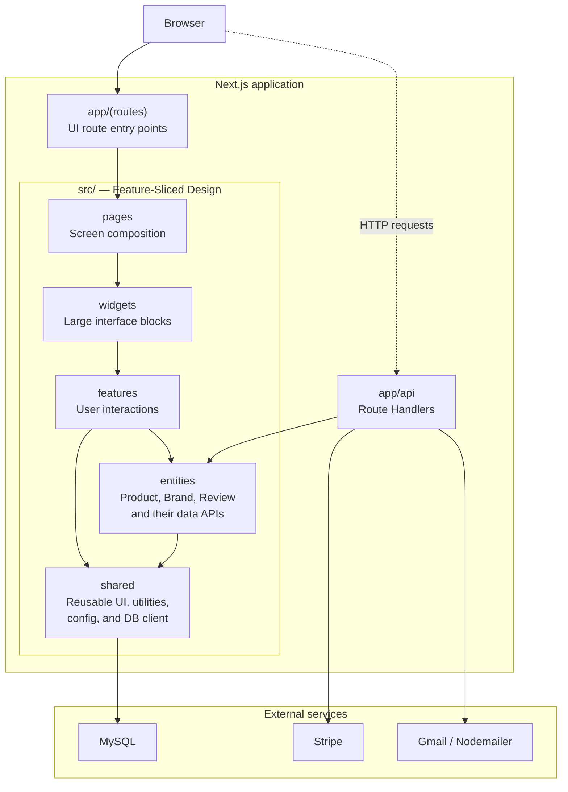

# PLAST-AVTO

> An auto-parts storefront with a catalogue, cart, reviews, and a demonstration payment flow.

[](#status) [](./LICENSE) [](https://nextjs.org/) [](https://react.dev/) [](https://www.typescriptlang.org/)

[](https://www.mysql.com/) [](https://stripe.com/) [](https://zustand.docs.pmnd.rs/) [](https://tailwindcss.com/)

<a id="contents"></a>

## Contents

- [About](#about)
- [Status](#status)
- [Features](#features)
- [Technology stack](#stack)
- [Quick start](#quick-start)
- [Environment variables](#environment)
- [Architecture](#architecture)
- [Routes and API](#routes)
- [Database](#database)
- [Commands](#commands)
- [Testing and CI](#testing)
- [Technical limitations and debt](#limitations)
- [License](#license)

<a id="about"></a>

## About

**PLAST-AVTO** is a web application for an automotive wheel-arch liner store. It was created as a foundation for a commercial website: users can browse and filter the catalogue, open product pages, add items to the cart, leave reviews, and proceed to payment through Stripe Checkout.

The application is fully migrated to TypeScript and is undergoing an active incremental architecture and production-readiness refactor. It is not a production-ready store for accepting real payments, but a codebase with a working domain model, database layer, HTTP API, checkout flow, and interface that can serve as a demo, learning project, or starting point for further development.

The application interface and copy are in Ukrainian; the configured contact details are placeholders.

<a id="status"></a>

## Status

The JavaScript-to-TypeScript migration is complete. Application source is maintained in TypeScript/TSX under strict compiler settings, and JavaScript application files are no longer part of the supported source layer.

The server and client foundations have also been split into clearer boundaries:

- database contracts and versioned migrations;
- typed environment configuration;
- entity DTOs, mappers, repositories, and server entry points;
- client-side entity APIs;
- catalogue and review Route Handlers;
- Stripe checkout, session verification, and webhook boundaries;
- isolated catalogue URL/data lifecycles;
- extracted review-form lifecycle and transport;
- extracted home brand-banner loading, sorting, pagination, and request lifecycle.

The current phase is focused on reducing remaining lifecycle and state-management debt, improving reproducible development data, persisting application-level orders, and strengthening production-facing protections and test coverage.

<a id="features"></a>

## Features

- Catalogue with search, brand filtering, sorting, pagination, and a “load more” button.
- A single dynamic page for both products and brands.
- Image gallery, related products, and product reviews.
- Global review feed and review submission.
- Home brand banner with mixed-script sorting and incremental loading.
- Zustand cart persisted in `localStorage`, with per-item quantity limits and a local order history.
- Stripe Checkout with server-derived prices and completed-payment verification.
- Durable Stripe webhook event deduplication.
- Order emails sent through Gmail/Nodemailer.
- Responsive UI with Tailwind CSS, Framer Motion animations, and Lucide icons.

<a id="stack"></a>

## Technology stack

| Area                | Solution                                                   |
| ------------------- | ---------------------------------------------------------- |
| Framework           | Next.js 16.4, App Router, React 19                         |
| Language            | TypeScript 5.9 / TSX                                       |
| Styling and UI      | Tailwind CSS 4, Headless UI, Framer Motion, Lucide, Swiper |
| State               | Zustand + `persist`                                        |
| Server and data     | Next.js Route Handlers, MySQL 8, `mysql2`                  |
| Validation          | Zod                                                        |
| Payments and emails | Stripe Checkout, Nodemailer 10 / Gmail                     |
| Quality tooling     | ESLint, Prettier, Vitest, Testing Library, Playwright      |
| Package manager     | Bun — lockfile: [bun.lock](./bun.lock)                     |
| CI                  | GitHub Actions                                             |

<a id="quick-start"></a>

## Quick start

### 1. Install dependencies

The repository is maintained with Bun. For a reproducible install, run:

```bash
bun install --frozen-lockfile
```

### 2. Configure MySQL and start Docker

Create a single local `.env` used by Docker and the database scripts. Start from `.env.example`, fill the `DB_*` application values, and add a strong `DB_ROOT_PASS` because it is required by Docker and `db:verify-empty`.

Docker ignores the extra `DB_HOST` key.

```powershell
Copy-Item .env.example .env
# Add DB_ROOT_PASS=<a strong local password> to .env before continuing.
docker compose up -d
```

MySQL will be available at `localhost:${DB_PORT}` (default: `3306`); Adminer is available at [http://localhost:8080](http://localhost:8080).

### 3. Configure optional integrations

For local Next.js-only overrides, create `.env.local` and add Stripe and email settings there.

Keep database settings in `.env`, because the `db:*` scripts load that file directly.

See the full list in [Environment variables](#environment).

### 4. Prepare the database

```bash
bun run db:migrate
bun run db:check
```

Migrations create and reconcile the canonical schema. They do not currently include catalogue content.

Until a versioned development seed is added, load a compatible data-only dump or seed separately and then run:

```bash
bun run db:check
```

### 5. Run the application

```bash
bun run dev
```

Open [http://localhost:3000](http://localhost:3000).

Use:

```bash
bun run dev:host
```

to expose the development server on `0.0.0.0`.

<a id="environment"></a>

## Environment variables

| Variable                    | Required for         | Notes                                                                           |
| --------------------------- | -------------------- | ------------------------------------------------------------------------------- |
| `DB_HOST`                   | MySQL                | `127.0.0.1` for the Docker setup above                                          |
| `DB_PORT`                   | MySQL                | Application-to-database port, usually `3306`                                    |
| `DB_USER` / `DB_PASS`       | MySQL                | Application credentials                                                         |
| `DB_NAME`                   | MySQL                | Database name                                                                   |
| `DB_ROOT_PASS`              | Docker / DB smoke    | Required by Docker MySQL and `bun run db:verify-empty`                          |
| `STRIPE_SECRET_KEY`         | Checkout and session | Required only when a Stripe checkout/session flow runs                          |
| `STRIPE_WEBHOOK_SECRET`     | Stripe webhook       | Verifies incoming events at `/api/stripe/webhook`                               |
| `APP_URL`                   | Checkout redirects   | Required in production; defaults to `http://localhost:3000` only in development |
| `EMAIL_USER` / `EMAIL_PASS` | Nodemailer           | Gmail SMTP credentials; an app password is recommended                          |
| `OWNER_EMAIL`               | Order notification   | Store owner’s email address                                                     |

[.env.example](./.env.example) and [.env.docker.example](./.env.docker.example) document the configuration with placeholders only.

Put real secrets in local `.env` / `.env.local`; never commit them.

Configuration is validated lazily:

- checkout/session use `STRIPE_SECRET_KEY`;
- `APP_URL` must be configured explicitly in production;
- webhook handling uses `STRIPE_SECRET_KEY` and `STRIPE_WEBHOOK_SECRET`;
- email configuration is validated only when an order email is sent.

For local webhook testing, configure Stripe CLI to forward events to:

```text
POST /api/stripe/webhook
```

Then store the issued signing secret in `STRIPE_WEBHOOK_SECRET`.

<a id="architecture"></a>

## Architecture

The project follows **Feature-Sliced Design (FSD)** inside `src`, while Next.js App Router provides the outer routing and HTTP layer.



> The diagram shows the typical direction of UI composition and dependencies. It is not a mandatory call sequence for every screen or request.

The current architecture has four key aspects:

1. **UI composition:** `app/(routes)` selects an FSD page, which composes the required widgets, features, entities, and shared UI according to FSD dependency rules.
2. **Data contracts:** repositories map MySQL rows to internal DTOs. Route Handlers serialize those DTOs into the current snake_case wire contracts consumed by client API modules.
3. **Client data access:** the browser calls an `app/api` Route Handler; it validates HTTP input, delegates to an entity server entry point, and ultimately reaches the shared MySQL client.
4. **Checkout flow:** Route Handlers obtain typed, lazy integration configuration. Checkout/session and webhook handlers use their own validated Stripe configuration, while completed Stripe webhook processing can trigger the Nodemailer email flow.

### FSD layers

| Layer      | Responsibility                     | Examples                                                                                                     |
| ---------- | ---------------------------------- | ------------------------------------------------------------------------------------------------------------ |
| `pages`    | Composes screens from blocks       | [`src/pages/products`](./src/pages/products), [`src/pages/order`](./src/pages/order)                         |
| `widgets`  | Independent, large screen sections | catalogue, cart, header, footer, checkout, banner                                                            |
| `features` | User actions                       | [`cart`](./src/features/cart), [`order/checkout`](./src/features/order/checkout), catalogue filters          |
| `entities` | Domain model and data access       | [`product`](./src/entities/product), [`brand`](./src/entities/brand), [`review`](./src/entities/review)      |
| `shared`   | Reusable infrastructure            | [`ui`](./src/shared/ui), [`db`](./src/shared/db), [`lib`](./src/shared/lib), [`config`](./src/shared/config) |

Server-side entity access is exposed through entry points such as [`src/entities/product/server.ts`](./src/entities/product/server.ts).

Server modules import `server-only` boundaries so MySQL code cannot be included in a client bundle. Browser-side requests live next to each entity under `api/client`.

### Client lifecycle boundaries

Complex client components are being reduced to presentation and orchestration responsibilities while data and request lifecycle logic is moved into model hooks and API modules.

Examples include:

- catalogue URL/navigation and data loading as separate lifecycles;
- review form loading and submission outside the UI component;
- brand banner loading, abort/stale-response protection, sorting, and pagination outside its presentation layer.

This keeps request behavior independently testable and reduces coupling between rendering and transport logic.

### Important distinction between `app` and `pages`

The root `app/` directory is **not the FSD `app` layer**: it is the Next.js App Router directory.

Likewise, `src/pages` is the FSD screen layer, not the Next.js Pages Router.

The root [`pages`](./pages) directory intentionally contains only a [placeholder README](./pages/README.md), preventing Next.js from mistaking `src/pages` for the legacy Pages Router.

Do not add routes to the root `pages/` directory.

### Product and brand route

The application has one:

```text
app/(routes)/products/[slug]
```

route.

A numeric `slug` is treated as a product `id`; otherwise it is treated as a brand slug.

This reduces the number of routes but imposes one constraint: a brand slug cannot consist solely of digits.

<a id="routes"></a>

## Routes and API

### User-facing routes

| URL                    | Screen                                       |
| ---------------------- | -------------------------------------------- |
| `/`                    | Home page                                    |
| `/products`            | Catalogue                                    |
| `/products/:id`        | Product page, when `:id` is numeric          |
| `/products/:brandSlug` | Brand products, when the slug is non-numeric |
| `/cart`                | Cart and local order history                 |
| `/order`               | Checkout and return status from Stripe       |
| `/reviews`             | Global review feed                           |
| `/contacts`            | Contacts                                     |

`(routes)` is a Next.js route group, so its name is not part of the URL.

### HTTP API

| Method and path                 | Purpose                                                                 |
| ------------------------------- | ----------------------------------------------------------------------- |
| `GET /api/products`             | Catalogue: `brand`, `q`, `sort`, `sort_by`, `page`, `limit`             |
| `GET /api/products?forSelect=1` | Lightweight `id`, `name`, and `model` list for selectors                |
| `GET /api/products/:id`         | Product, images, and related products; `:id` is decimal only            |
| `GET /api/brands`               | All brands                                                              |
| `GET /api/reviews`              | Review feed; optional `productId`, `page`, and `limit`                  |
| `POST /api/reviews`             | Create a review; non-empty `comment` is required, `authorName` nullable |
| `POST /api/stripe/checkout`     | Create a Checkout Session from server-loaded product prices             |
| `GET /api/stripe/session`       | Verify a Checkout Session using its HttpOnly ownership proof            |
| `POST /api/stripe/webhook`      | Verify, deduplicate, and process Stripe payment events                  |

The shared [`ErrorHandler`](./src/shared/lib/errorHandler.ts) turns expected 4xx Route Handler errors into:

```json
{
  "ok": false,
  "message": "..."
}
```

Unexpected failures are logged on the server and return a neutral 500 response.

<a id="database"></a>

## Database

The application connects to MySQL through the pool in [`src/shared/db/mysql.ts`](./src/shared/db/mysql.ts).

The versioned schema is stored in [`db/migrations`](./db/migrations). It includes the catalogue, reviews, Stripe webhook idempotency, foreign keys, indexes, and the `reviews.rating` range constraint.

Apply migrations to a configured database with:

```bash
bun run db:migrate
```

Use:

```bash
bun run db:check
```

to validate both the schema and catalogue data integrity.

Use:

```bash
bun run db:check:schema
```

to validate only the SQL contract.

For a reproducibility check:

```bash
bun run db:verify-empty
```

creates and removes an isolated empty database, runs migrations as the application user, and executes catalogue/review smoke queries.

This command is intended for local Docker MySQL and requires `DB_ROOT_PASS`. It never touches `DB_NAME`.

The canonical tables are:

| Table                   | Usage                                                                   |
| ----------------------- | ----------------------------------------------------------------------- |
| `products`              | Catalogue, product page, prices, `brand_id`, `brand_slug`, main image   |
| `product_images`        | Additional product images: `product_id`, `image_url`                    |
| `brands`                | Brand list                                                              |
| `reviews`               | Reviews: `product_id`, `rating`, `author_name`, `comment`, `created_at` |
| `stripe_webhook_events` | Durable Stripe webhook idempotency records                              |
| `schema_migrations`     | Applied migration identifiers                                           |

Migrations create the structure, not catalogue content.

A versioned, repeatable development catalogue seed remains a separate engineering task.

<a id="commands"></a>

## Commands

| Command                   | Action                                            |
| ------------------------- | ------------------------------------------------- |
| `bun run dev`             | Start Next.js development mode with Turbopack     |
| `bun run dev:host`        | Start the development server on `0.0.0.0`         |
| `bun run build`           | Build the production application                  |
| `bun run start`           | Start the built application                       |
| `bun run lint`            | Run ESLint                                        |
| `bun run lint:fix`        | Apply available ESLint fixes                      |
| `bun run format`          | Format files with Prettier                        |
| `bun run check`           | Run ESLint, Prettier check, and `tsc --noEmit`    |
| `bun run audit:prod`      | Audit production dependencies                     |
| `bun run test`            | Start Vitest in watch mode                        |
| `bun run test:run`        | Run the Vitest suite once                         |
| `bun run test:coverage`   | Generate a V8 coverage report                     |
| `bun run test:e2e`        | Run Playwright end-to-end tests                   |
| `bun run db:migrate`      | Apply versioned database migrations               |
| `bun run db:check`        | Validate schema and catalogue data integrity      |
| `bun run db:check:schema` | Validate only the canonical schema contract       |
| `bun run db:verify-empty` | Rebuild and smoke-test an isolated empty database |

<a id="testing"></a>

## Testing and CI

The project uses:

- Vitest;
- jsdom;
- Testing Library;
- V8 coverage;
- Playwright;
- GitHub Actions.

Vitest configuration lives in [`vitest.config.ts`](./vitest.config.ts), with shared setup in [`tests/setup.ts`](./tests/setup.ts).

The unit/component suite covers areas including:

- typed environment boundaries;
- security helpers;
- request schemas and runtime validation;
- product/review/brand mapper behavior;
- checkout schemas and Stripe mappers;
- Stripe session verification;
- Stripe client isolation;
- catalogue loading and navigation behavior;
- brand-product and related-product data hooks;
- product review loading;
- global review feed behavior;
- checkout state;
- cart UI behavior;
- contact interactions;
- header navigation;
- home brand-banner lifecycle;
- review form behavior.

Playwright provides a public-home-page smoke test through:

```bash
bun run test:e2e
```

End-to-end coverage is intentionally small at this stage and should expand as order persistence and production-facing flows become more stable.

### Continuous integration

GitHub Actions runs on pull requests and pushes to `main`.

The quality job uses a frozen Bun install and runs:

```bash
bun run audit:prod
bun run check
bun run test:run
bun run build
```

A separate MySQL-backed database job runs:

```bash
bun run db:verify-empty
```

against a clean database to verify that migrations can recreate the expected schema and support catalogue/review smoke queries.

CI currently uses Bun `1.4.2`.

<a id="limitations"></a>

## Technical limitations and debt

This is deliberately a candid list for the next refactoring and production-readiness phases.

- **React Hooks 7.1 lint adoption is not complete.** The project uses the current Next.js ESLint stack, but `react-hooks/set-state-in-effect` and `react-hooks/refs` are temporarily disabled while existing lifecycle patterns are migrated deliberately with characterization coverage.

- **The cart and “past orders” are local.** Zustand `persist` stores them in the browser; they are not synchronized across devices and disappear when browser storage is cleared.

- **Orders are not persisted.** Stripe webhook idempotency is durable, but checkout sessions and orders still lack an application-level order record. That also leaves the temporary one-active-session cookie limitation in place.

- **There is no authentication, anti-spam protection, or rate limiting.** Review input has runtime validation, but the endpoint remains public. Do not expose it as a production service without request-rate limits and abuse protection.

- **There is no repeatable catalogue seed.** A fresh environment can recreate the schema but cannot yet recreate development catalogue content from the repository alone.

- **End-to-end coverage is intentionally small.** The project has a Playwright smoke path, but checkout, reviews, catalogue interactions, and failure scenarios need broader browser-level coverage before production use.

- **Related products are selected heuristically.** The code extracts digits from `products.model`, searches for matches within the same brand, and limits the result to four products. A catalogue with stricter business rules needs an explicit relationship.

- **Contact details are placeholders.** Replace [`CONTACTS`](./src/shared/config/contacts.ts) and the map with real values before deployment.

- **Payments and email depend on external configuration.** Stripe checkout requires Stripe credentials, while order notification emails require Gmail/Nodemailer credentials. The current payment UI is intended for Stripe test mode.

### Next engineering priorities

1. Adopt the stricter React Hooks 7.1 lint rules and refactor the remaining affected state/effect lifecycles.
2. Add a versioned, non-production catalogue seed and resolve any data-integrity findings reported by `bun run db:check`.
3. Persist orders and checkout sessions in the database.
4. Add authentication and protection for public endpoints, including rate limiting and abuse controls.
5. Expand API integration and Playwright end-to-end coverage for critical user flows.
6. Add production observability and operational error reporting.
7. Configure production contacts, domain settings, Stripe webhook delivery, and secure email delivery.

<a id="license"></a>

## License

This project is distributed under the [MIT License](./LICENSE).
